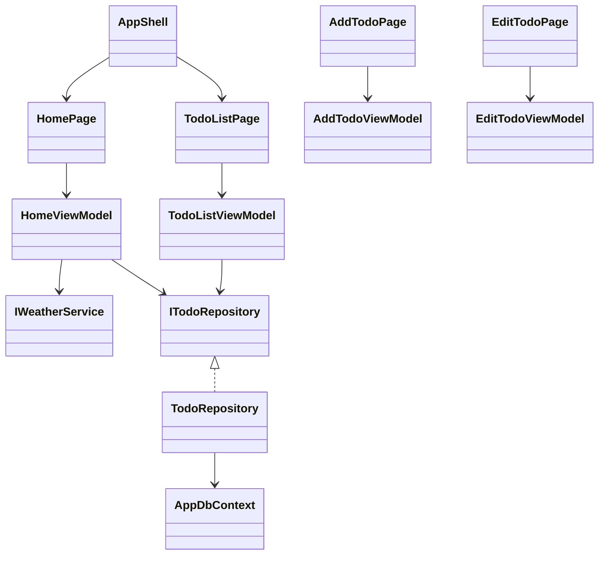

# Life Management App

A .NET 9 MAUI course project for managing tasks, categories, priorities, due dates, and weather. The repository includes both the original MAUI client and a browser client.

## Safest way to run the browser client on Windows

This project was blocked on one Windows installation by Smart App Control. The Code Integrity log reported that `LifeManagementApp.Web.dll` did not meet the enterprise signing requirements. The safe development workaround is to run only the static browser files with Node; this does not disable Windows security or launch the blocked .NET executable.

From the repository root, run:

```powershell
node .\LifeManagementApp.Web\static-server.mjs
```

Open [http://127.0.0.1:5087](http://127.0.0.1:5087) in a browser. The static server is implemented in [LifeManagementApp.Web/static-server.mjs](LifeManagementApp.Web/static-server.mjs) and serves only [LifeManagementApp.Web/wwwroot](LifeManagementApp.Web/wwwroot).

### Browser-only behavior

When the ASP.NET API is unavailable, [app.js](LifeManagementApp.Web/wwwroot/app.js) automatically switches to offline mode:

- Tasks and categories are stored in a SQLite database running in WebAssembly; IndexedDB stores the exported SQLite file between visits.
- Weather uses the direct Open-Meteo geocoding and forecast endpoints.
- The kitesurf alert is active when wind speed is over 5 m/s; exactly 5 m/s does not trigger it.
- Data in offline mode is local to that browser and is not written to the server's SQLite database. The first offline load downloads the pinned `sql.js` WebAssembly runtime from jsDelivr.

The browser client still prefers the ASP.NET API when it is available, so the same UI can use server-backed SQLite persistence during normal development.

## Full ASP.NET web host

If Windows permits the .NET web host, run:

```powershell
dotnet run --project .\LifeManagementApp.Web\LifeManagementApp.Web.csproj --urls http://127.0.0.1:5087
```

The web host reuses the task models, SQLite repository, and weather service. Its API provides task and category persistence. Set `LIFE_APP_DATABASE_PATH` to an absolute SQLite path when an isolated database is needed.

If Code Integrity blocks the web host, do not use Defender exclusions or registry bypasses. An administrator must approve the application through the device's application-control policy, or all application binaries must be signed with a certificate trusted by Windows. Smart App Control does not provide a safe per-project trust command.

## MAUI build

Install the .NET 9 SDK and the `maui-windows` workload, then run:

```powershell
dotnet build .\LifeManagementApp\LifeManagementApp.csproj -f net9.0-windows10.0.19041.0
```

The MAUI client contains task storage, task CRUD, categories, sorting/filtering, and a weather card. It may require administrator approval on devices enforcing enterprise signing policies.

## Testing and development checks

Run the test project with:

```powershell
dotnet test .\LifeManagementApp.Tests\LifeManagementApp.Tests.csproj
```

If the test host is also blocked by Code Integrity, the project can still be compiled; run the tests on an approved development machine or ask the administrator to approve the test binaries.

For front-end changes, validate the JavaScript before opening the browser client:

```powershell
node --check .\LifeManagementApp.Web\wwwroot\app.js
```

The SQLite repository uses an EF Core Code First context. The initial schema uses `EnsureCreated`; before changing a released schema, introduce and apply EF Core migrations instead of relying on `EnsureCreated`.

## Architecture

The MAUI client follows a small MVVM structure:



- **Views** contain layout, bindings, semantic descriptions, and navigation-facing page lifecycle hooks.
- **ViewModels** expose observable state and commands; they do not reference controls or perform UI-specific work.
- **Services** provide persistence, navigation, and weather lookup behind interfaces so view models can be tested with fakes.
- **Models** hold task/category/weather data and validation rules.
- **Data** contains the EF Core SQLite context.

The browser client mirrors the same task and weather concepts. Its ASP.NET host exposes JSON endpoints, while the static safe mode uses the same UI with browser storage when the host cannot be trusted by Windows.

## Application conventions

- Priority is an integer from 1 to 5; larger values are more important.
- Home shows the first three open tasks ordered by descending priority, then earliest due date.
- The task list can sort by priority, due date, or title and can filter by category.
- Weather uses Open-Meteo. Wind speed is requested and displayed in metres per second; kitesurf conditions are considered available only above 5 m/s.
- Navigation is provided through `INavigationService`, keeping view models independent of Shell and page controls.
- The repository and weather service are registered as singletons; pages and view models are transient so navigation receives fresh screen state. `AppDbContext` is created through `AddDbContextFactory` for short-lived database operations.

## Persistence and limitations

The normal MAUI and ASP.NET modes store tasks in SQLite under the application data directory. `LIFE_APP_DATABASE_PATH` can point to an explicit database file for development. The initial schema uses `EnsureCreated`, so production schema changes should move to EF Core migrations.

The static safe mode stores a browser-local SQLite database in IndexedDB; it is intentionally not a replacement for shared server-side SQLite persistence. Weather and the first SQLite WebAssembly load require network access, and the Windows target may require enterprise approval for unsigned development binaries.

## Workflow and contribution notes

Use one feature branch per issue, keep commits focused, and reference the issue in the branch, commit, or pull request. Build the relevant project, run the tests, and document any environment limitation before merging. Do not disable Smart App Control or add broad Defender exclusions to make development binaries run.

AI assistance was used for code exploration, test scaffolding, documentation drafting, and review of the safe browser fallback. All generated changes were inspected, built, and tested where the local security policy allowed execution; the developer remains responsible for the final design, security decisions, and acceptance review.

## Presentation checklist

For a criterion-specific walkthrough, demonstrate: adding a validated task; priority and due-date ordering; the top-three home preview; category creation and filtering; editing, completion, deletion, and persistence; weather lookup and the over-5 m/s kitesurf threshold; offline/error behavior; and the difference between server-backed SQLite mode and browser-only safe mode.

## Code walkthrough

This section is a presentation guide. The comments in the source explain local decisions; this list explains where to look and how the pieces connect.

### Startup and navigation

- [MauiProgram.cs](LifeManagementApp/MauiProgram.cs) creates the MAUI application, registers SQLite, services, pages, and ViewModels with dependency injection, and chooses their lifetimes.
- [App.xaml](LifeManagementApp/App.xaml) defines application-wide resources such as styles and value converters.
- [App.xaml.cs](LifeManagementApp/App.xaml.cs) creates the first application window and uses [AppShell.xaml](LifeManagementApp/AppShell.xaml) as its visual root.
- [AppShell.xaml](LifeManagementApp/AppShell.xaml) defines the Home and To-dos destinations that appear in Shell navigation.
- [AppShell.xaml.cs](LifeManagementApp/AppShell.xaml.cs) registers the add and edit detail routes.
- [ShellNavigationService.cs](LifeManagementApp/Services/ShellNavigationService.cs) hides Shell route strings behind `INavigationService`, so ViewModels do not call `Shell.Current` directly.

### Models and database

- [TodoItem.cs](LifeManagementApp/Models/TodoItem.cs) is the main task model. It contains the required fields, the category relationship, the archive state, and DataAnnotations validation.
- [Category.cs](LifeManagementApp/Models/Category.cs) represents a category and its one-to-many relationship with tasks.
- [WeatherSnapshot.cs](LifeManagementApp/Models/WeatherSnapshot.cs) is the normalized weather object shown by the UI. Its `KitesurfConditions` property contains the `WindSpeed > 5` rule.
- [AppDbContext.cs](LifeManagementApp/Data/AppDbContext.cs) is EF Core’s map of the SQLite database. It exposes `TodoItems` and `Categories` and configures category deletion.
- [ITodoRepository.cs](LifeManagementApp/Services/ITodoRepository.cs) defines the storage operations used by the application.
- [TodoRepository.cs](LifeManagementApp/Services/TodoRepository.cs) creates short-lived EF Core contexts, initializes SQLite, upgrades older databases with the archive column, and performs async CRUD operations.

### Services

- [IWeatherService.cs](LifeManagementApp/Services/IWeatherService.cs) defines the weather service contract.
- [OpenMeteoWeatherService.cs](LifeManagementApp/Services/OpenMeteoWeatherService.cs) first geocodes a city, then requests its forecast from Open-Meteo with `wind_speed_unit=ms`, maps JSON into `WeatherSnapshot`, and translates weather codes into readable text.
- [INavigationService.cs](LifeManagementApp/Services/INavigationService.cs) defines navigation actions without exposing UI controls to ViewModels.

### ViewModels

- [HomeViewModel.cs](LifeManagementApp/ViewModels/HomeViewModel.cs) loads unfinished tasks, orders them by priority and due date, limits the result to three items, and manages weather loading/error state.
- [TodoListViewModel.cs](LifeManagementApp/ViewModels/TodoListViewModel.cs) owns the task list projection. It applies category filters, sort order, active/archive view, hide-done state, single-task archive actions, and bulk done-task actions.
- [AddTodoViewModel.cs](LifeManagementApp/ViewModels/AddTodoViewModel.cs) loads categories and validates a new task before calling the repository.
- [EditTodoViewModel.cs](LifeManagementApp/ViewModels/EditTodoViewModel.cs) loads a task by the Shell-passed id, edits its fields, and saves it through the repository.

### Views and binding

- [HomePage.xaml](LifeManagementApp/Views/HomePage.xaml) binds the HomeViewModel to the top-three list, weather card, loading indicator, and kitesurf alert.
- [HomePage.xaml.cs](LifeManagementApp/Views/HomePage.xaml.cs) refreshes Home when it appears and starts/stops the 15-second weather timer with the page lifecycle.
- [TodoListPage.xaml](LifeManagementApp/Views/TodoListPage.xaml) contains the `CollectionView`, filters, sort picker, category form, archive controls, and task buttons.
- [TodoListPage.xaml.cs](LifeManagementApp/Views/TodoListPage.xaml.cs) refreshes the list when returning to the page.
- [AddTodoPage.xaml](LifeManagementApp/Views/AddTodoPage.xaml) and [AddTodoPage.xaml.cs](LifeManagementApp/Views/AddTodoPage.xaml.cs) display the add form and load current categories.
- [EditTodoPage.xaml](LifeManagementApp/Views/EditTodoPage.xaml) and [EditTodoPage.xaml.cs](LifeManagementApp/Views/EditTodoPage.xaml.cs) display the edit form and receive the task id through Shell query parameters.
- [TaskCompletionTextConverter.cs](LifeManagementApp/Converters/TaskCompletionTextConverter.cs) changes `Done` to `Undo` after completion.
- [ArchiveTextConverter.cs](LifeManagementApp/Converters/ArchiveTextConverter.cs) changes `Archive` to `Unarchive` for archived tasks.

### Tests

- [TaskFlowTests.cs](LifeManagementApp.Tests/TaskFlowTests.cs) tests ViewModel behavior such as validation, ordering, filtering, categories, editing, and the wind threshold.
- [TodoItemTests.cs](LifeManagementApp.Tests/TodoItemTests.cs) tests the model’s title and priority validation boundaries.
- [TodoRepositoryTests.cs](LifeManagementApp.Tests/TodoRepositoryTests.cs) tests SQLite persistence across separate contexts, categories, updates, deletion, and validation.
- [WeatherServiceTests.cs](LifeManagementApp.Tests/WeatherServiceTests.cs) tests JSON mapping and verifies that Open-Meteo is requested in metres per second.

### Browser client

- [Program.cs](LifeManagementApp.Web/Program.cs) is the ASP.NET Core host. It registers the shared services, initializes SQLite, serves the browser files, and exposes `/api/tasks`, `/api/categories`, and `/api/weather`.
- [app.js](LifeManagementApp.Web/wwwroot/app.js) stores browser UI state, calls the API, renders task HTML, handles task actions, refreshes weather, and falls back to browser-local SQLite when the API is unavailable.
- [index.html](LifeManagementApp.Web/wwwroot/index.html) defines the browser page structure and form controls.
- [app.css](LifeManagementApp.Web/wwwroot/app.css) defines the visual design and responsive mobile layout.
- [static-server.mjs](LifeManagementApp.Web/static-server.mjs) serves only `wwwroot` for the safe browser-only mode; it does not run the .NET API.

The platform files under [Platforms](LifeManagementApp/Platforms) are MAUI-generated startup and packaging adapters for Android, iOS, Mac Catalyst, Windows, and Tizen. They let the same application project start correctly on each platform; the task and weather logic stays in the shared folders above. The icon, font, splash, and style files under [Resources](LifeManagementApp/Resources) provide visual assets and shared appearance rather than application behavior.

## How .NET MAUI works in this project

MAUI is one .NET application that can create native controls for several platforms. The shared C# and XAML files contain the app’s behavior and layouts; MAUI builds them into a Windows, Android, iOS, Mac Catalyst, or Tizen application using the selected platform target.

1. The platform entry point starts MAUI and calls `MauiProgram.CreateMauiApp()`.
2. `MauiProgram` registers dependencies. When a page asks for a ViewModel in its constructor, the DI container creates the ViewModel and supplies its repository, navigation service, and weather service.
3. `App` creates an `AppShell`. Shell provides the navigation stack and the Home/To-dos flyout.
4. A XAML page creates the visual tree: labels, buttons, pickers, entries, and `CollectionView` items.
5. `BindingContext` connects the page to a ViewModel. Bindings move values from `[ObservableProperty]` fields to controls, and `[RelayCommand]` generates commands that buttons can call.
6. A user action calls a ViewModel command. The ViewModel validates input and calls an interface such as `ITodoRepository`; it does not manipulate a button or text box directly.
7. The repository creates an EF Core `AppDbContext` from the registered factory, performs an async SQLite query or update, and returns model objects.
8. CommunityToolkit.Mvvm raises property-change notifications automatically. The page updates when the ViewModel changes `Items`, `Weather`, `IsBusy`, or an error message.
9. Page lifecycle methods such as `OnAppearing` refresh data. The Home page starts a `PeriodicTimer` for weather and cancels it in `OnDisappearing` so hidden pages do not keep making requests.

The important separation is: **View = presentation, ViewModel = screen behavior, Service/Repository = external work, Model = data and rules**. This is why the same repository and weather service can be used by both the MAUI client and the ASP.NET browser host, and why the ViewModels can be tested without opening a real device window.
