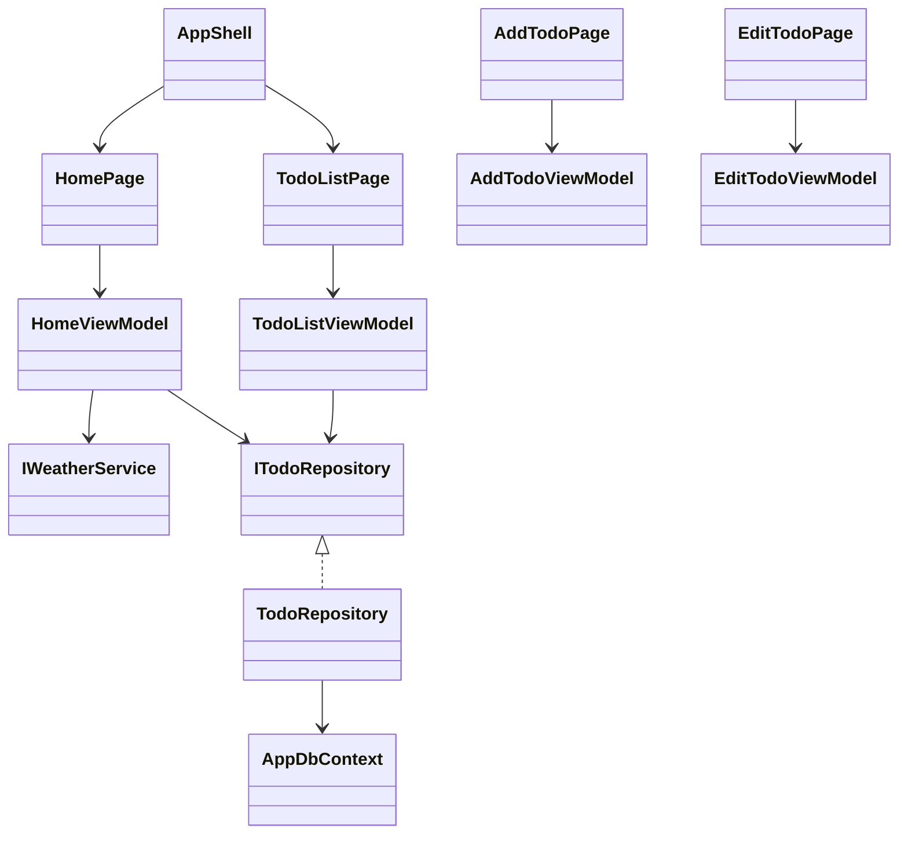

# Life Management App

A .NET 9 MAUI course project for managing tasks, categories, priorities, due dates, and weather. The repository includes both the original MAUI client and a browser client.

## Safest way to run the browser client on Windows

This project was blocked on one Windows installation by Smart App Control. The Code Integrity log reported that `LifeManagementApp.Web.dll` did not meet the enterprise signing requirements. The safe development workaround is to run only the static browser files with Node; this does not disable Windows security or launch the blocked .NET executable.

From the repository root, run:

```powershell
node .\LifeManagementApp.Web\static-server.mjs
```

Open [http://127.0.0.1:5087](http://127.0.0.1:5087) in a browser. The static server is implemented in [LifeManagementApp.Web/static-server.mjs](LifeManagementApp.Web/static-server.mjs) and serves only [LifeManagementApp.Web/wwwroot](LifeManagementApp.Web/wwwroot).

### Browser-only behavior

When the ASP.NET API is unavailable, [app.js](LifeManagementApp.Web/wwwroot/app.js) automatically switches to offline mode:

- Tasks and categories are stored in a SQLite database running in WebAssembly; IndexedDB stores the exported SQLite file between visits.
- Weather uses the direct Open-Meteo geocoding and forecast endpoints.
- The kitesurf alert is active at wind speeds of 5 m/s or higher.
- Data in offline mode is local to that browser and is not written to the server's SQLite database. The first offline load downloads the pinned `sql.js` WebAssembly runtime from jsDelivr.

The browser client still prefers the ASP.NET API when it is available, so the same UI can use server-backed SQLite persistence during normal development.

## Full ASP.NET web host

If Windows permits the .NET web host, run:

```powershell
dotnet run --project .\LifeManagementApp.Web\LifeManagementApp.Web.csproj --urls http://127.0.0.1:5087
```

The web host reuses the task models, SQLite repository, and weather service. Its API provides task and category persistence. Set `LIFE_APP_DATABASE_PATH` to an absolute SQLite path when an isolated database is needed.

If Code Integrity blocks the web host, do not use Defender exclusions or registry bypasses. An administrator must approve the application through the device's application-control policy, or all application binaries must be signed with a certificate trusted by Windows. Smart App Control does not provide a safe per-project trust command.

## MAUI build

Install the .NET 9 SDK and the `maui-windows` workload, then run:

```powershell
dotnet build .\LifeManagementApp\LifeManagementApp.csproj -f net9.0-windows10.0.19041.0
```

The MAUI client contains task storage, task CRUD, categories, sorting/filtering, and a weather card. It may require administrator approval on devices enforcing enterprise signing policies.

## Testing and development checks

Run the test project with:

```powershell
dotnet test .\LifeManagementApp.Tests\LifeManagementApp.Tests.csproj
```

If the test host is also blocked by Code Integrity, the project can still be compiled; run the tests on an approved development machine or ask the administrator to approve the test binaries.

For front-end changes, validate the JavaScript before opening the browser client:

```powershell
node --check .\LifeManagementApp.Web\wwwroot\app.js
```

The SQLite repository uses an EF Core Code First context. The initial schema uses `EnsureCreated`; before changing a released schema, introduce and apply EF Core migrations instead of relying on `EnsureCreated`.

## Architecture

The MAUI client follows a small MVVM structure:



- **Views** contain layout, bindings, semantic descriptions, and navigation-facing page lifecycle hooks.
- **ViewModels** expose observable state and commands; they do not reference controls or perform UI-specific work.
- **Services** provide persistence, navigation, and weather lookup behind interfaces so view models can be tested with fakes.
- **Models** hold task/category/weather data and validation rules.
- **Data** contains the EF Core SQLite context.

The browser client mirrors the same task and weather concepts. Its ASP.NET host exposes JSON endpoints, while the static safe mode uses the same UI with browser storage when the host cannot be trusted by Windows.

## Application conventions

- Priority is an integer from 1 to 5; larger values are more important.
- Home shows the first three open tasks ordered by descending priority, then earliest due date.
- The task list can sort by priority, due date, or title and can filter by category.
- Weather uses Open-Meteo. Wind speed is requested and displayed in metres per second; kitesurf conditions are considered available at 5 m/s or above.
- Navigation is provided through `INavigationService`, keeping view models independent of Shell and page controls.
- The repository and weather service are registered as singletons; pages and view models are transient so navigation receives fresh screen state. `AppDbContext` is created through `AddDbContextFactory` for short-lived database operations.

## Persistence and limitations

The normal MAUI and ASP.NET modes store tasks in SQLite under the application data directory. `LIFE_APP_DATABASE_PATH` can point to an explicit database file for development. The initial schema uses `EnsureCreated`, so production schema changes should move to EF Core migrations.

The static safe mode stores a browser-local SQLite database in IndexedDB; it is intentionally not a replacement for shared server-side SQLite persistence. Weather and the first SQLite WebAssembly load require network access, and the Windows target may require enterprise approval for unsigned development binaries.

## Workflow and contribution notes

Use one feature branch per issue, keep commits focused, and reference the issue in the branch, commit, or pull request. Build the relevant project, run the tests, and document any environment limitation before merging. Do not disable Smart App Control or add broad Defender exclusions to make development binaries run.

AI assistance was used for code exploration, test scaffolding, documentation drafting, and review of the safe browser fallback. All generated changes were inspected, built, and tested where the local security policy allowed execution; the developer remains responsible for the final design, security decisions, and acceptance review.

## Presentation checklist

For a criterion-specific walkthrough, demonstrate: adding a validated task; priority and due-date ordering; the top-three home preview; category creation and filtering; editing, completion, deletion, and persistence; weather lookup and the inclusive 5 m/s kitesurf threshold; offline/error behavior; and the difference between server-backed SQLite mode and browser-only safe mode.
